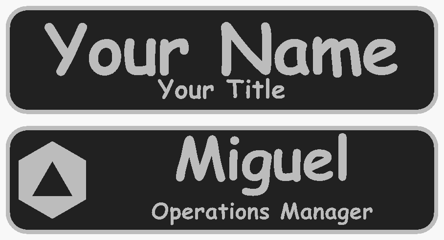
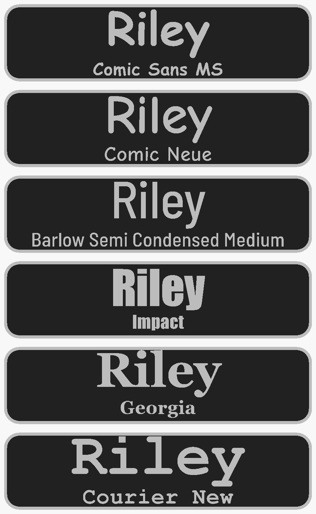

# scad-tag

a blank parametric name tag. drop in your own svg, type a name and a title, get a 3mf. one openscad file.

the plate is 100 x 25 x 3 mm by default. a 2 mm base, with the rim, logo, name and title raised 1 mm on top of it. its the plate from a staff tag i printed for great lakes gaming, with everything that was specific to that store taken out. that version lives on as a fork, [glg-nametag](https://github.com/skyphose/glg-nametag).



## what you need

- openscad 2021.01 or newer.
- comic sans ms, which is the default. it comes with macos and windows. its a microsoft font so its not in this repo.
- on linux, or anywhere without comic sans, pick comic neue. its a free lookalike and it ships in `fonts/`.

check the font before you export anything: help > font list in openscad. if the font you picked isnt listed, openscad does NOT warn you. it quietly swaps in a default font and the tag comes out in the wrong typeface.

## how to make a tag

1. clone or download the repo. keep `tag.scad`, `fonts.scad` and `fonts/` together.
2. open `tag.scad`, then window > customizer.
3. type the name and the title. leave the title blank for a name-only tag.
4. F6, then file > export > 3mf or stl.

with no logo the text gets the whole plate, 94 mm of width between the margins.

## adding your logo

1. put your svg next to `tag.scad`.
2. type its file name into `logo_file`.
3. set `logo_aspect` to its width divided by its height. `python3 tools/svg_aspect.py your-logo.svg` prints it.
4. pick `logo_side`, left or right.

openscad cant measure an svg on its own, which is why step 3 exists. get it wrong and the logo comes out stretched. the batch script does it for you: `LOGO=your-logo.svg ./export_tags.sh`.

what the svg has to be:

- one color, filled shapes. openscad imports fills. a logo drawn only with strokes comes in as nothing.
- no bakcground rectangle. a box behind the logo prints as a solid block.
- holes as real holes, like the triangle in `examples/example-logo.svg`.

## fonts

`name_font` and `title_font` are separate, so a heavy name and a plain title is one setting each.

14 fonts are in the dropdown and in `fonts.scad`, with their real letter widths. for those, long text shrinks to fit exactly.

| font | where it comes from |
|---|---|
| comic sans ms, bold or regular | macos, windows |
| comic neue bold | bundled, free |
| barlow semi condensed medium / semibold | bundled, free |
| din pro medium | paid, install it yourself |
| liberation sans bold | built into openscad |
| arial, verdana, trebuchet ms, georgia, times new roman, courier new (bold), impact | macos, windows |



any other installed font works too. set a font to Custom and type its name into `custom_font`, exactly as help > font list shows it. without its widths the script guesses from arial bold, so a narrow font comes out smaller than it needs to and a wide one can crowd the rim. `custom_width_factor` corrrects it by eye.

to make a font exact, measure it once:

```
pip install fonttools
python3 tools/font_metrics.py "/path/to/Your Font Bold.ttf"
```

paste the line it prints into `FONT_METRICS` in `fonts.scad`. after that the font is exact, under the name the line starts with.

## how the text fits

the name gets 12 mm capitals and the title 4.5 mm, or 14 mm for a name with no title. then two things can shrink it:

- too wide, and that line shrinks until it fits the width.
- too tall, and both lines shrink together until they fit the height. tails on g, j, p, q and y count, so a name with a y in it sits higher and a little smaller than one without.

comic sans bold, no logo:

| name / title | name caps | title caps |
|---|---|---|
| Your Name / Your Title | 12 mm | 4.5 mm |
| Riley / Judge | 10.4 mm | 3.9 mm |
| Alexandria / Operations Manager | 12 mm | 4.5 mm |
| Christopher / Tournament Organizer & Head Judge | 10.9 mm | 3.4 mm |
| Sam, no title | 14 mm | |

Riley drops to 10.4 because of the tails on the y and the g in Judge. the example logo takes 18.6 mm of width, so long text with a logo comes out a little smaller again.

## what you can change

everything is in the customizer, grouped the same way.

| group | settings |
|---|---|
| text | `name`, `title`, `all_caps` |
| batch | `batch_mode`, `batch_list`, `batch_columns`, `batch_gap` |
| font | `name_font`, `title_font`, `custom_font`, `custom_width_factor` |
| size | `name_cap_height` 12, `name_cap_height_solo` 14, `title_cap_height` 4.5, `line_gap` 1.2, letter spacing, align, margins, nudges |
| logo | `logo_file`, `logo_aspect`, `logo_height` 18, `logo_side`, `logo_text_gap` 3, `logo_thicken` |
| plate | 100 x 25 mm, `base_thickness` 2, `raised_height` 1, `corner_radius` 5, `rim_width` 1 |
| back | none, two 10.2 mm magnet pockets 1.2 mm deep, or a 26 x 6 mm pin bar recess |
| export | `part`: all, base only, raised only, logo only, text and rim only. preview colors |

for a sheet of tags: tick `batch_mode` and fill in `batch_list` as `Name:Title, Name:Title, Name`, or fill in `names.csv` and run `./export_tags.sh` for one 3mf per person.


## two colors

everything above z = 2.0 mm is the raised stuff. on a single-nozzle printer, add a filamnet change at 2.0 mm. with an ams or a toolchanger, export `part = "Base only"` and `part = "Raised only"` and load both into the slicer as one object.

## limits

- comic sans isnt bundled and cant be. if you send the file to someone on linux, tell them to switch to comic neue.
- custom fonts without a line in `fonts.scad` are estimated. measure them with `tools/font_metrics.py` if the size matters.
- the title gets small fast. a 33-character title with a long name drops to 3.4 mm, and 3 mm with a logo. under about 3 mm the strokes get close to the width of a 0.4 mm nozzle line. thats estimated from the fonts, not printed.
- `logo_aspect` is set by hand in the customizer. the batch script works it out, the customizer cant.
- text curves are drawn at 32 segments instead of 64. at 64, comic sans made a sliver that broke the export. you wont see the difference at this size.
- the magnet pockets leave 0.8 mm of plate under the magnet. it works in cad, untested in print.

the plate has been printed, as the glg tag. comic sans, the other fonts and custom logos havent, not on this plate. print one and check it before you print a sheet.

## files

| path | what it is |
|---|---|
| `tag.scad` | the model |
| `fonts.scad` | letter widths for the 14 known fonts |
| `fonts/` | comic neue bold and barlow semi condensed, with their licenses (ofl) |
| `tools/svg_aspect.py` | prints an svg's width / height for `logo_aspect` |
| `tools/font_metrics.py` | measures any font file into a `fonts.scad` line |
| `names.csv`, `export_tags.sh` | batch export, one 3mf per line |
| `examples/example-logo.svg` | a plain hexagon with a triangle cut out, to test with |
| `dist/` | example models and the renders in this readme |

## license

the model, `fonts.scad` and the scripts are cc by-nc-sa 4.0, see `LICENSE.txt`. comic neue and barlow are under the sil open font license. comic sans ms, din pro and the other system fonts arent included.
