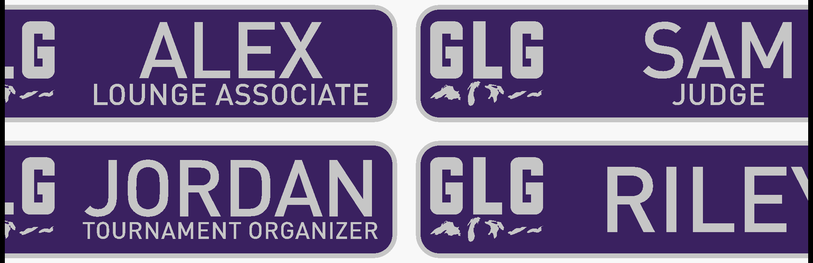

# glg-nametag

a parametric staff name tag for great lakes gaming. one openscad file, type a name and a title, get a 3mf.

its a fork of [scad-tag](https://github.com/skyphose/scad-tag), the blank version. this fork only changes the defaults: the glg logo, din pro medium, all caps, purple and white, and a wider gap between the logo and the text. fixes to the model land in scad-tag first and get pulled in here.

the plate is 100 x 25 x 3 mm. a 2 mm base, with the rim, logo, name and title raised 1 mm on top of it. its a modified version of a tag i drew in fusion and printed. same plate, same rim, same 1 mm relief. what changed is the glg logo and text that sizes itself, so nobody redraws it for every new hire.

## what you need

- openscad 2021.01 or newer.
- din pro medium installed on the machine running openscad. its a paid font and its not in this repo.
- nothing else. the logo and the backup font are in here.

check the font before you export anything: help > font list in openscad, search "din pro". if it isnt listed, openscad does NOT warn you. it quietly swaps in a default font and the tag comes out in the wrong typeface. if you dont have din pro, set `name_font` and `title_font` to barlow semi condensed. its a free din lookalike and it ships in `fonts/`.

## how to make a tag

1. clone or download the repo. keep `tag.scad`, `fonts.scad`, `glg_logo.svg` and `fonts/` together.
2. open `tag.scad`, then window > customizer.
3. type the name and the title. leave the title blank for a name-only tag.
4. F6, then file > export > 3mf or stl.

for a whole staff sheet there are two ways:

- batch mode in the customizer. tick `batch_mode` and fill in `batch_list` as `Name:Title, Name:Title, Name`. you get one plate with every tag on it.
- `names.csv` plus `./export_tags.sh`. one 3mf per person, in `exports/`.

## how it works

the logo sits on the left at 18 mm tall, with a 5 mm gap after it. everything to the right of that, 64.9 mm wide, is the text area. the name goes on top with 12 mm capitals and the title sits under it at 4.5 mm.

long text shrinks to fit that width instead of running off the plate. the script carires the real letter widths of din pro medium, so it knows how wide a word will be before it draws it. it shrinks one line at a time and only as far as it has to.

| what you type | cap height you get |
|---|---|
| a name up to about 6 letters (ALEX, JORDAN) | 12 mm, full size |
| ALEXANDRIA, 10 letters | 7.7 mm |
| CHRISTOPHER, 11 letters | 7 mm |
| LOUNGE ASSOCIATE, 16 characters | 4.5 mm, full size |
| TOURNAMENT ORGANIZER, 20 characters | 3.6 mm |
| TOURNAMENT ORGANIZER & HEAD JUDGE, 33 characters | 2.3 mm, too small, see below |

a name with no title gets 14 mm capitals and sits in the middle.

## what you can change

everything is in the customizer, grouped the same way as below.

| group | settings |
|---|---|
| text | `name`, `title`, `all_caps` (on by default, turn it off to keep mixed case) |
| batch | `batch_mode`, `batch_list`, `batch_columns`, `batch_gap` |
| font | `name_font`, `title_font`: din pro medium by default, 13 others in the dropdown, or any installed font as custom |
| size | `name_cap_height` 12, `name_cap_height_solo` 14, `title_cap_height` 4.5, `line_gap` 1.2, letter spacing, align, nudges |
| logo | `logo_file`, `logo_height` 18, `logo_aspect` 1.339, `logo_text_gap` 5, `logo_side`, `logo_thicken` |
| plate | 100 x 25 mm, `base_thickness` 2, `raised_height` 1, `corner_radius` 5, `rim_width` 1 |
| back | none, two 10.2 mm magnet pockets 1.2 mm deep, or a 26 x 6 mm pin bar recess |
| export | `part`: all, base only, raised only, logo only, text and rim only |

## two colors

everything above z = 2.0 mm is the raised stuff. so on a single-nozzle printer, add a filament change at 2.0 mm and you get a purple plate with white text. if you have an ams or a toolchanger, export `part = "Base only"` and `part = "Raised only"`, drag both into the slicer together and load them as one object.

## limits

- the title gets small fast. past about 20 cahracters it drops under 4 mm, and the 33-character one in the table comes out at 2.3 mm. under about 3 mm the strokes get close to the width of a 0.4 mm nozzle line. thats estimated from the font, not printed. keep titles short.
- names over 6 letters lose size. an 11-letter name is 7 mm instead of 12. still readable across a counter, but not the same weight as a short name next to it.
- the lakes in the logo are the finest detail on the tag. if they come out ragged, `logo_thicken` 0.1 to 0.2 mm fattens them.
- the magnet pockets leave 0.8 mm of plate under the magnet. it works in cad, untested in print.
- the shrink knows the letter widths of the 14 fonts in `fonts.scad`. any other font is estimated, see the scad-tag readme for how to measure it.
- the full glg base logo, the one with GREAT LAKES GAMING under it, doesnt work at this size. the wordmark comes out about 1 mm tall. thats why this uses the glg and lakes mark only.

the plate has been printed. the glg logo and the self-sizing text havent, not at these sizes. print one tag and check it before you print a whole staff sheet.

## files

| path | what it is |
|---|---|
| `tag.scad` | the model, glg defaults |
| `fonts.scad` | letter widths for the 14 known fonts |
| `glg_logo.svg` | glg and lakes mark, single color, no background |
| `fonts/` | barlow semi condensed and comic neue, with their licenses (ofl) |
| `tools/` | svg aspect and font measuring scripts, from scad-tag |
| `names.csv`, `export_tags.sh` | batch export, one 3mf per line |
| `dist/models-3mf/` | an example tag and a four-tag batch plate |
| `dist/models-stl/` | the same example split into base and raised parts |
| `dist/images/` | the renders in this readme |

## license

the model and the scripts are cc by-nc-sa 4.0, see `LICENSE.txt`. the great lakes gaming name and the glg logo belong to great lakes gaming and arent covered by that license. barlow and comic neue are under the sil open font license. din pro isnt inncluded.
